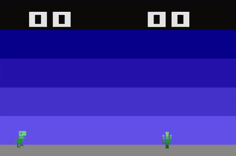

# Dino

A Chrome dino style endless runner for the Atari 2600, written in 6502 assembly.

### [▶ Play in your browser](https://javatari.org/?ROM=https://raw.githubusercontent.com/Strongato/dino-atari2600/main/release/Dino_v1.0.0.bin)

**Click the game screen first**, then use <kbd>↑</kbd> to jump and <kbd>↓</kbd> to fall faster.

Jump over cacti to score points. 
Every 5 points the cacti get faster. Hit one and your score resets.

